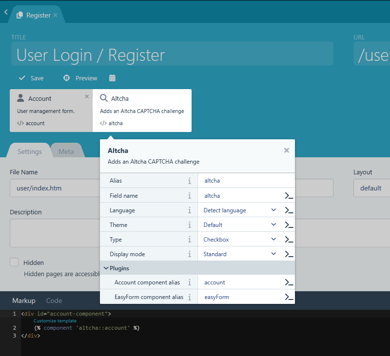

# Altcha plugin

This plugin provides support for the [ALTCHA](https://altcha.org/) anti-spam service, helping to prevent form spam and bot registration on your Winter CMS install. By default, this plugin works with the User plugin to protect the user registration form, but can be extended to any Winter CMS plugin.

## Installation

This plugin is available for installation via [Composer](http://getcomposer.org/).

```bash
composer require winter/wn-altcha-plugin
```

After installing the plugin you will need to run the migrations and (if you are using a [public folder](https://wintercms.com/docs/develop/docs/setup/configuration#using-a-public-folder)) [republish your public directory](https://wintercms.com/docs/develop/docs/console/setup-maintenance#mirror-public-files).

## Usage

### With the User plugin

If you have the [Winter User plugin](https://github.com/wintercms/wn-user-plugin) installed, this plugin provides a drop-in replacement for the default registration form. You may select the page that is using the Account component, and add the Altcha component to the page.



Ensure that the **Account component alias** property in the Altcha component is set to the same alias as the Account component on the page (defaults to `account`). You must then include the Altcha widget in your page markup. If you use the default User component markup, you can simply change the `account` component to `altcha::account` in your page markup.

```

```

If you have customised the User component markup, you may instead include the Altcha widget directly in your page markup, within the registration form.

```

```

### With other plugins

If you wish to verify a form submission from another plugin, you must ensure that the Altcha widget is included in your form submission:

```

```

On the server-side, as part of your plugin, you can verify the Altcha response by calling the `verify` method on the `Winter\Altcha\Classes\Altcha` class. This class is a singleton, so you can access it anywhere via the following code:

```php
use Winter\Altcha\Classes\Altcha;

$value = post('altcha_field');
Altcha::instance()->verify($value);
```

Ensuring that you retrieve the payload from the correct Altcha POST field. The component allows you to specify the name of the POST field (prefixed with the component's alias) - by default, this will be `altcha_altcha`.

The `verify` method will throw one of the following exceptions, depending on the result of the verification:

| Exception | Meaning |
| --------- | ------- |
| `Winter\Altcha\Exceptions\NoCaptchaException` | The Altcha field was not present in the form submission. |
| `Winter\Altcha\Exceptions\InvalidPayloadException` | The Altcha field was present, but the payload sent through was invalid or could not be processed. |
| `Winter\Altcha\Exceptions\NotVerifiedException` | The Altcha field was present and payload was valid, but the challenge was not successfully verified. |

### Adding targets for other forms

If you want to target other custom components' AJAX handlers, you can call the addTargets() method of the Altcha class:

```php
use Winter\Altcha\Classes\Altcha;

Altcha::instance()->addTargets([
    'Your\Custom\Component' => ['handler'],
]);
```

You can also replace the default targets completely by using the `setTargets()` method.

## Component properties

The Altcha component has the following properties:

| Property | Description |
| -------- | ----------- |
| `fieldName` | The name of the Altcha field sent via POST. |
| `language` | The language of the Altcha challenge, or set to "Detect language" to automatically detect based on the HTML lang attribute or browser settings. |
| `theme` | The theme of the Altcha challenge. |
| `type` | The type of the Altcha challenge. |
| `displayMode` | The display mode of the Altcha challenge. |
| `accountComponent` | The alias of the Account component if used with the User plugin. |
| `easyformComponent` | The alias of the EasyForm component if used with the EasyForm plugin. |

## Widget customization

You can customize the appearance and behavior of the Altcha widget by using the component properties described above. For example, you can set the language, theme, type, and display mode to match your site's design and user experience requirements.

In addition, you can use custom CSS to further style the widget according to your needs.

```css
/* Example custom CSS for the Altcha widget */
altcha-widget {
    --altcha-checkbox-border-width: 1.5px;                                      /* Width of the checkbox border */
    --altcha-color-base: oklch(36.993% 0.14552 265.614);                        /* Base color of the widget */
    --altcha-color-base-content: oklch(96.183% 0.0235 227.909);                 /* Content color for the base */
    --altcha-color-neutral: oklch(46.768% 0.15756 266.404);                     /* Neutral color of the widget */
    --altcha-color-neutral-content: var(--altcha-color-base-content);           /* Content color for the neutral color */
    --altcha-color-primary: oklch(60.683% 0.10883 309.763);                     /* Primary color of the widget */
    --altcha-color-primary-content: oklch(96.014% 0.0162 293.609);              /* Content color for the primary color */
    --altcha-border-color: light-dark(
        oklch(27.079% 0.14584 265.379), 
        oklch(46.768% 0.15756 266.404)
    );                                                                          /* Border color of the widget */
    --altcha-input-background-color: light-dark(
        oklch(100% 0.00011 271.152),
        oklch(25.197% 0.00003 271.152)
    );                                                                          /* Background color of input fields */
    --altcha-input-color: light-dark(
        oklch(27.07 9% 0.14584 265.379), 
        oklch(96.014% 0.0162 293.609)
    );                                                                          /* Text color of input fields */
    --altcha-switch-background-color: var(--altcha-input-background-color);     /* Background color of switch elements */
    --altcha-checkbox-border-color: var(--altcha-color-neutral);                /* Border color of checkboxes */
    --altcha-spinner-color: var(--altcha-color-base-content);                   /* Color of the spinner */
}
```